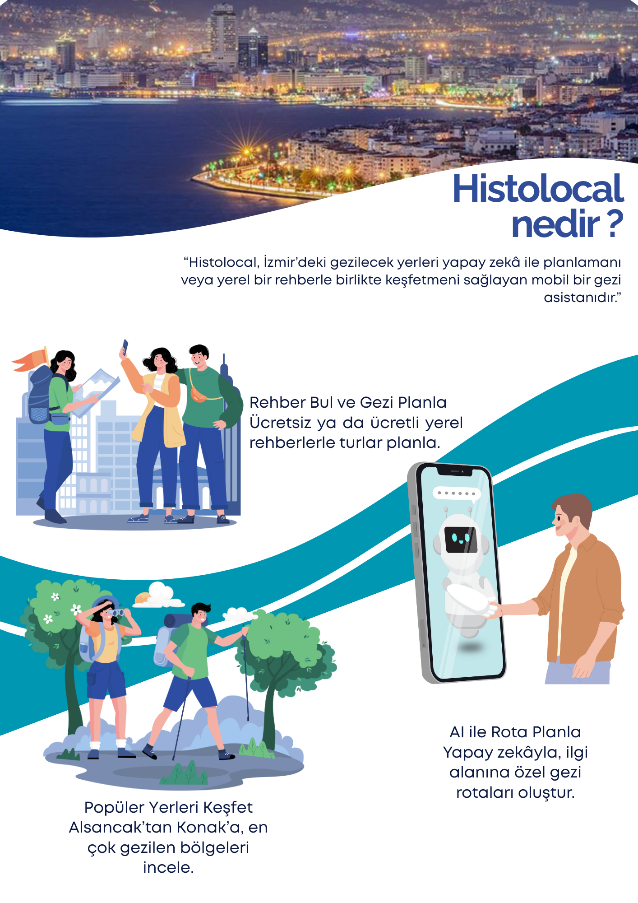
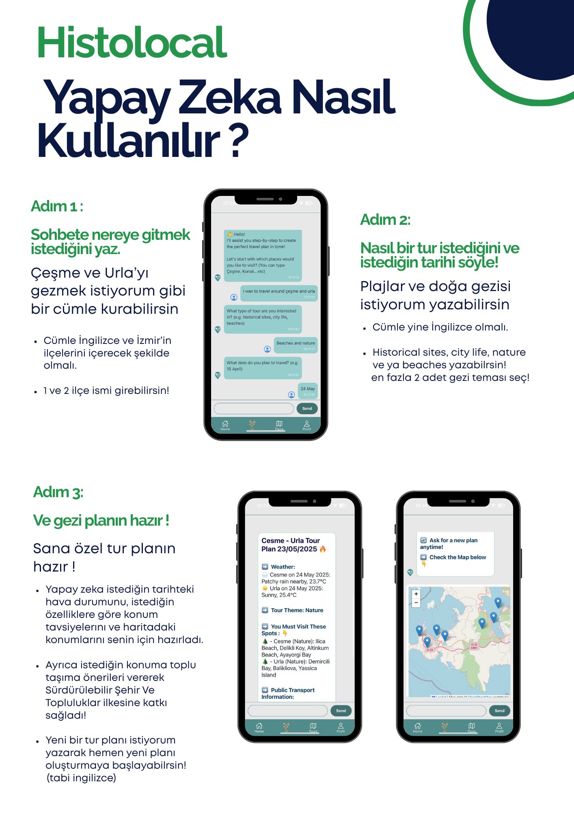
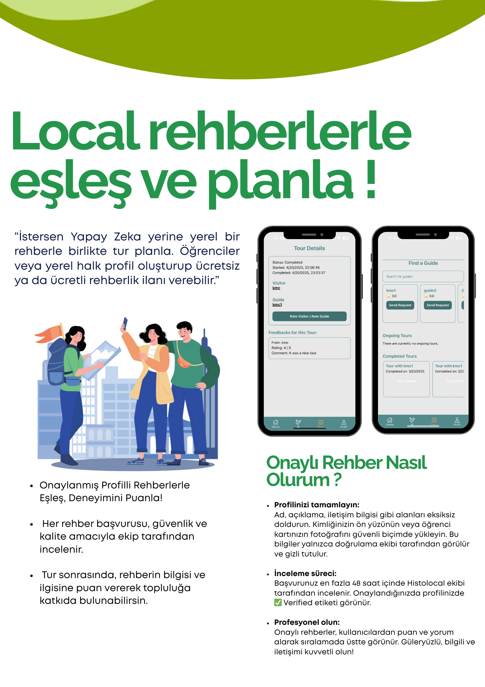
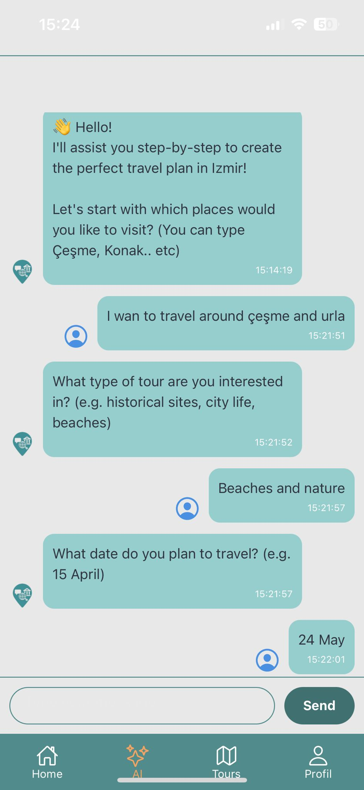
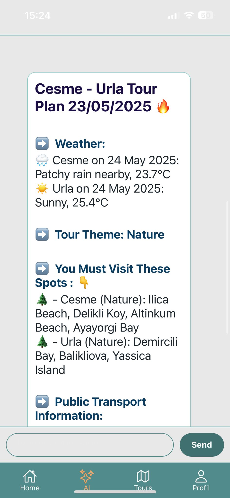
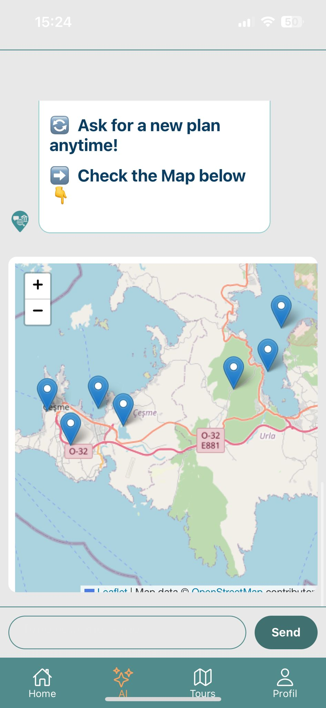

# Histolocal – Smart Travel Assistant Platform

AI-powered Travel Assistant for Cultural Discovery in İzmir

| What is Histolocal | How to Use | Match With Guides |
|------------------|-----------------|----------------|
|  |  |  |
---

## About the Project

Histolocal is a mobile travel assistant designed to help visitors explore İzmir through:
- AI-generated personalized itineraries
- Local guide matching and tour requests
- Interactive map views and transport suggestions
- Secure login and user verification
- Cross-platform mobile experience (iOS & Android)

Powered by Ollama AI and built with a modular architecture, Histolocal is a prototype of scalable smart tourism software.

---

## Screenshots

| AI-Generated Plan | Map Integration | Personalized Tour |
|------------------|-----------------|----------------|
|  |  |  |

---

## System Architecture

### Frontend (React Native + Expo)
- Cross-platform mobile app
- Supports Visitor & Guide roles with AI chat, map, tours, and feedback
- Communicates via REST APIs

### Backend (Node.js + Express)
- JWT authentication, role-based access
- Handles tour requests, user feedback
- Connects frontend, AI, and database

### AI Server (FastAPI + Ollama + ChromaDB)
- Generates itineraries based on district, preferences, and date
- Uses ChromaDB for semantic filtering
- Supports guide content preparation

### Database (MongoDB)
- Stores users, tours, ratings, requests
- Easy to extend with schema-less structure

### External APIs
- WeatherAPI for real-time forecasts
- Leaflet / OpenStreetMap for map display
- Google Maps (optional) for route and street views

---

## How It Works

Histolocal supports two user roles — each with its own flow.

### Visitor Experience

1. Logs in as a Visitor  
2. Explores the homepage with location and guide suggestions  
3. Creates a personalized itinerary using the AI Assistant or  
4. Matches with a guide for collaborative tour planning  
5. Schedules and completes a tour  
6. Leaves feedback for the guide  

Visitors can freely explore or receive intelligent guidance tailored to their needs.

---

### Guide Experience

1. Logs in as a Guide  
2. Sees available tour requests and demand per district  
3. Accepts or declines visitor tour requests  
4. Uses the AI Assistant to prepare optimized tour plans  
5. Posts free or paid tour listings on their profile  
6. Verifies their identity to become a trusted guide  
7. Completes tours and builds a rated profile  

Guides enhance visitor experiences by offering local insights and AI-enhanced planning.

---

## 📘 Türkçe

# Histolocal – Akıllı Seyahat Asistanı Platformu

İzmir'de kültürel keşif için yapay zeka destekli seyahat yardımcısı

| Histolocal Nedir? | Nasıl Kullanılır? | Yerel Rehberlerle Eşleş |
|------------------|-----------------|----------------|
|  |  |  |

---

## Proje Hakkında

Histolocal, kullanıcıların İzmir’i akıllı bir şekilde keşfetmesini sağlayan mobil bir seyahat uygulamasıdır:
- Yapay zeka destekli kişiselleştirilmiş tur planlaması
- Rehber eşleştirme ve tur isteği gönderme
- Harita üzerinde önerilen yerler ve ulaşım bilgileri
- Güvenli kullanıcı girişi ve kimlik doğrulama
- iOS ve Android uyumlu platform

Ollama AI altyapısıyla güçlendirilmiş, modüler bir mimariye sahip olan Histolocal, ölçeklenebilir akıllı turizm sistemlerinin bir prototipidir.

---

## Ekran Görselleri

| AI-Turu | Harita Entegrasyonu | Kişiselleştirilmiş Tur |
|------------------|-----------------|----------------|
|  |  |  |

---

## Sistem Mimarisi

### Ön Yüz (React Native + Expo)
- iOS ve Android için mobil uygulama
- Ziyaretçi ve Rehber rolleri için ekranlar (AI, harita, tur, yorum)
- REST API üzerinden arka uçla iletişim kurar

### Arka Uç (Node.js + Express)
- JWT ile kimlik doğrulama, rol bazlı erişim
- Tur taleplerini ve geri bildirimleri yönetir
- Ön yüz, AI ve veritabanı ile bağlantı kurar

### Yapay Zeka Sunucusu (FastAPI + Ollama + ChromaDB)
- İlçe, kategori ve tarih girdilerine göre tur önerisi üretir
- Anlamsal filtreleme için ChromaDB kullanır
- Rehberler için tur içeriği önerisi de sunar

### Veritabanı (MongoDB)
- Kullanıcılar, turlar, yorumlar ve istekler burada tutulur
- Şemasız yapısıyla kolay genişletilebilir

### Harici API’ler
- Hava durumu verisi: WeatherAPI
- Harita ve konum gösterimi: Leaflet / OpenStreetMap
- Gerekirse rota ve sokak görünümü: Google Maps

---

## Nasıl Çalışır?

Histolocal, her biri kendine özgü akışlara sahip iki farklı kullanıcı türünü destekler.

### Ziyaretçi Akışı

1. Ziyaretçi olarak giriş yapar  
2. Ana sayfada konum önerileri ve müsait rehberleri keşfeder  
3. Yapay zeka ile kişisel tur planı oluşturabilir  
4. Veya rehber ile eşleşip birlikte plan yapabilir  
5. Turu planlar ve tamamlar  
6. Rehbere geri bildirim bırakır  

Ziyaretçiler dilerse serbestçe gezebilir, dilerse akıllı rehberlik alabilir.

---

### Rehber Akışı

1. Rehber olarak giriş yapar  
2. Ana sayfada tur taleplerini ve ilçe bazlı yoğunluğu görüntüler  
3. Gelen talepleri kabul veya reddeder  
4. AI yardımıyla tur içerikleri planlayabilir  
5. Ücretsiz veya ücretli tur ilanları oluşturabilir  
6. Kimliğini yükleyerek "Doğrulanmış Rehber" olabilir  
7. Turları tamamlayarak profilini puanlarla güçlendirir  

Rehberler, ziyaretçilere yerel bilgilerle zenginleştirilmiş turlar sunar.

